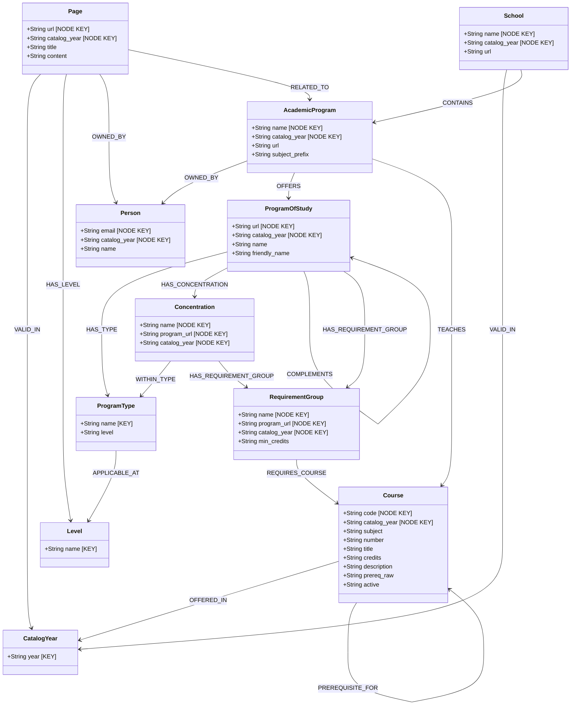

# SJF Catalog Knowledge Graph — Neo4j Schema

**St. John Fisher University | Catalog Graph RAG Pipeline**
**Schema Version:** 2.0
**Last Updated:** November 2026
**Catalog Year:** 2026-2027

---

## Overview

This document describes the Neo4j knowledge graph schema derived from the SJF WordPress catalog XML export. The graph models the full academic catalog — institutional hierarchy, programs of study, concentrations, courses, prerequisites, content owners, and catalog pages — in a multi-year-aware structure.

---

## Node Labels & Properties

| Node Label | Node Key | Additional Properties |
|---|---|---|
| `CatalogYear` | `year` | — |
| `Level` | `name` | — |
| `ProgramType` | `name` | `level` |
| `School` | `name, catalog_year` | `url` |
| `AcademicProgram` | `name, catalog_year` | `url`, `subject_prefix` |
| `Person` | `email, catalog_year` | `name` |
| `Page` | `url, catalog_year` | `title`, `content` |
| `ProgramOfStudy` | `url, catalog_year` | `name`, `friendly_name` |
| `Concentration` | `name, program_url, catalog_year` | — |
| `RequirementGroup` | `name, program_url, catalog_year` | `min_credits` |
| `Course` | `code, catalog_year` | `subject`, `number`, `title`, `credits`, `description`, `prereq_raw`, `restrictions`, `attributes`, `active` |

---

## ProgramType Values

| Name | Level | Can Have Concentration? | Complements a Degree? |
|---|---|---|---|
| `Undergraduate Degree` | Undergraduate | ✅ Yes | — |
| `Graduate Degree` | Graduate | ✅ Yes | — |
| `Minor` | Inherited from degree | ❌ No | ✅ Yes |
| `Certificate` | Inherited from degree | ❌ No | ✅ Yes |

---

## Entity-Relationship Diagram



---

## Relationships Summary

| Relationship | Start Node | End Node | Notes |
|---|---|---|---|
| `VALID_IN` | `School`, `ProgramOfStudy`, `Course`, `Page` | `CatalogYear` | Multi-year scoping |
| `CONTAINS` | `School` | `AcademicProgram` | Institutional hierarchy |
| `OFFERS` | `AcademicProgram` | `ProgramOfStudy` | One AP can offer multiple PoS |
| `TEACHES` | `AcademicProgram` | `Course` | Inferred from subject prefix |
| `OWNED_BY` | `AcademicProgram`, `Page` | `Person` | Content owner / dept chair |
| `HAS_TYPE` | `ProgramOfStudy` | `ProgramType` | Degree, Minor, Certificate |
| `APPLICABLE_AT` | `ProgramType` | `Level` | UG or GR |
| `HAS_CONCENTRATION` | `ProgramOfStudy` | `Concentration` | Degree programs only |
| `WITHIN_TYPE` | `Concentration` | `ProgramType` | Scopes concentration to degree type |
| `COMPLEMENTS` | `ProgramOfStudy` (Minor/Cert) | `ProgramOfStudy` (Degree) | Minor/Certificate → parent Degree |
| `HAS_REQUIREMENT_GROUP` | `ProgramOfStudy`, `Concentration` | `RequirementGroup` | Core and track requirements |
| `REQUIRES_COURSE` | `RequirementGroup` | `Course` | Curriculum requirements |
| `OFFERED_IN` | `Course` | `CatalogYear` | Course availability by year |
| `PREREQUISITE_FOR` | `Course` | `Course` | Self-referential prereq chain |
| `HAS_LEVEL` | `Page` | `Level` | UG, GR, or both (two edges) |
| `RELATED_TO` | `Page` | `AcademicProgram` | Optional, where determinable |

---

## Neo4j Constraints

```cypher
CREATE CONSTRAINT catalog_year_unique IF NOT EXISTS
  FOR (c:CatalogYear) REQUIRE c.year IS UNIQUE;

CREATE CONSTRAINT level_name_unique IF NOT EXISTS
  FOR (l:Level) REQUIRE l.name IS UNIQUE;

CREATE CONSTRAINT progtype_name_unique IF NOT EXISTS
  FOR (pt:ProgramType) REQUIRE pt.name IS UNIQUE;

CREATE CONSTRAINT school_node_key IF NOT EXISTS
  FOR (s:School) REQUIRE (s.name, s.catalog_year) IS NODE KEY;

CREATE CONSTRAINT academic_program_node_key IF NOT EXISTS
  FOR (ap:AcademicProgram) REQUIRE (ap.name, ap.catalog_year) IS NODE KEY;

CREATE CONSTRAINT program_of_study_url_key IF NOT EXISTS
  FOR (p:ProgramOfStudy) REQUIRE (p.url, p.catalog_year) IS NODE KEY;

CREATE CONSTRAINT concentration_node_key IF NOT EXISTS
  FOR (c:Concentration) REQUIRE (c.name, c.program_url, c.catalog_year) IS NODE KEY;

CREATE CONSTRAINT req_group_key IF NOT EXISTS
  FOR (r:RequirementGroup) REQUIRE (r.name, r.program_url, r.catalog_year) IS NODE KEY;

CREATE CONSTRAINT course_node_key IF NOT EXISTS
  FOR (c:Course) REQUIRE (c.code, c.catalog_year) IS NODE KEY;

CREATE CONSTRAINT person_email_key IF NOT EXISTS
  FOR (p:Person) REQUIRE (p.email, p.catalog_year) IS NODE KEY;

CREATE CONSTRAINT page_url_key IF NOT EXISTS
  FOR (pg:Page) REQUIRE (pg.url, pg.catalog_year) IS NODE KEY;
```

---

## Neo4j Indexes

```cypher
CREATE INDEX course_title_idx IF NOT EXISTS FOR (c:Course) ON (c.title);
CREATE INDEX program_name_idx IF NOT EXISTS FOR (p:ProgramOfStudy) ON (p.name);
```

---

## XML Source Field Mappings

| Graph Property | WordPress XML Source |
|---|---|
| `Course.code` | `ct_Subject_Co_text_46b1` + `ct_Course_Num_text_be9d` |
| `Course.credits` | `ct_Credit_Hou_text_b8a9` |
| `Course.prereq_raw` | `ct_Prerequisi_editor_e687` |
| `Course.restrictions` | `ct_Restrictio_editor_4933` |
| `Course.attributes` | `ct_Course_Att_text_888e` |
| `ProgramOfStudy.level` | `ct_College_Co_selectbox_9443` (`UG` / `GR`) |
| `ProgramOfStudy.friendly_name` | `ct_Friendly_N_text_8b77` |
| `AcademicProgram.subject_prefix` | `ct_Course_Pre_text_ea2e` |
| `Person.name` | `ct_Content_Ow_text_6429` |
| `Person.email` | `ct_Content_Ow_text_1cdf` |
| `Concentration` (detected) | `<h2>`/`<h3>` headings in `ct_Program_Re_editor_226b` containing keywords: `concentration`, `track`, `specialization`, `pathway` |
| `RequirementGroup` | Section headings in `ct_Program_Re_editor_226b` and `ct_Minor_editor_f6ff` |
| `Page.level` | Inferred from URL path (`/undergraduate/` vs `/graduate/`) |

---

## Example Queries

```cypher
// All Programs of Study offered by a specific Academic Program
MATCH (ap:AcademicProgram {name: 'Biology', catalog_year: '2026-2027'})
      -[:OFFERS]->(pos:ProgramOfStudy)
RETURN pos.name AS ProgramOfStudy, pos.program_type AS Type;

// All concentrations available within Undergraduate Degrees
MATCH (pt:ProgramType {name: 'Undergraduate Degree'})<-[:WITHIN_TYPE]-(con:Concentration)
      <-[:HAS_CONCENTRATION]-(pos:ProgramOfStudy {catalog_year: '2026-2027'})
RETURN pos.name AS Degree, con.name AS Concentration
ORDER BY Degree, Concentration;

// Minors that complement a specific degree
MATCH (minor:ProgramOfStudy)-[:COMPLEMENTS]->(degree:ProgramOfStudy {
  name: 'B.S. Biology',
  catalog_year: '2026-2027'
})
RETURN minor.name AS AvailableMinors;

// Full degree audit path through a concentration
MATCH path = (pos:ProgramOfStudy {catalog_year: '2026-2027'})
             -[:HAS_CONCENTRATION]->(con:Concentration)
             -[:HAS_REQUIREMENT_GROUP]->(rg:RequirementGroup)
             -[:REQUIRES_COURSE]->(c:Course)
RETURN path LIMIT 25;

// Content owners and their managed programs
MATCH (ap:AcademicProgram {catalog_year: '2026-2027'})-[:OWNED_BY]->(owner:Person)
RETURN owner.name AS ContentOwner, owner.email AS Email,
       collect(ap.name) AS ManagedPrograms
ORDER BY size(ManagedPrograms) DESC;

// All undergraduate policy pages
MATCH (pg:Page {catalog_year: '2026-2027'})-[:HAS_LEVEL]->(:Level {name: 'Undergraduate'})
RETURN pg.title, pg.url
ORDER BY pg.title;

// Pages that apply to both levels (institution-wide)
MATCH (pg:Page {catalog_year: '2026-2027'})
WHERE size([(pg)-[:HAS_LEVEL]->() | 1]) = 2
RETURN pg.title AS InstitutionWidePages;
```

---

## Pipeline Scripts

| Script | Purpose |
|---|---|
| `load_catalog_from_xml.py` | Primary ingestion pipeline — parses WordPress XML and loads all nodes/relationships |
| `step1_schema_setup.py` | Standalone constraint and index setup |
| `step2_crawler.py` | Sitemap crawler — maps school and program URLs |
| `step3_scraper.py` | HTML scraper for supplemental program content |
| `step4_neo4j_loader.py` | Legacy loader (superseded by `load_catalog_from_xml.py`) |

---

## Multi-Year Loading

```bash
# Load a specific catalog year
python load_catalog_from_xml.py --year 2026-2027
python load_catalog_from_xml.py --year 2025-2026
python load_catalog_from_xml.py --year 2024-2025

# Load with explicit XML path
python load_catalog_from_xml.py --xml /path/to/catalog.xml --year 2026-2027
```

Each catalog year is isolated via composite node keys — loading a new year never overwrites existing year data.
